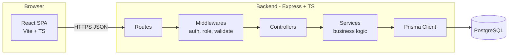
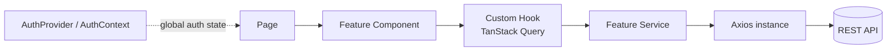
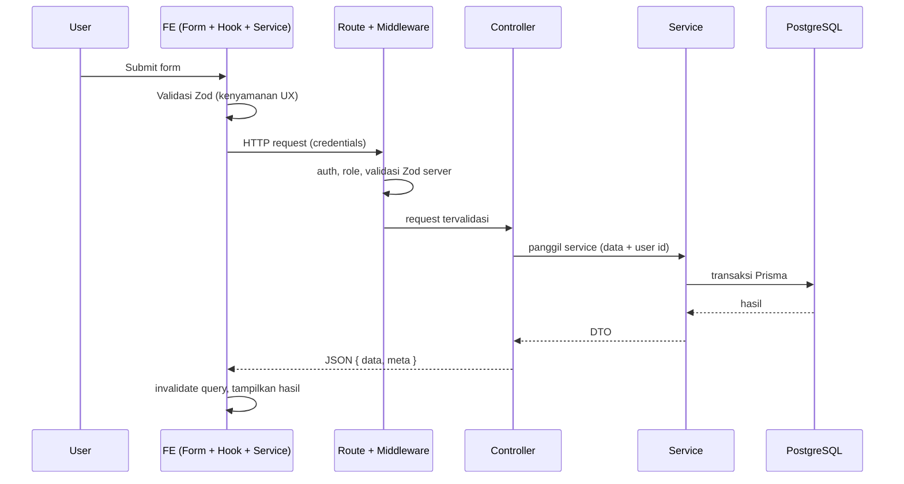

# ARCHITECTURE — KP Optik Raihan

> **Tujuan:** mendefinisikan arsitektur sistem, tanggung jawab layer, alur request, dan penanganan error.
> **Status:** DRAFT, menunggu review developer
> **Versi:** 0.1.0
> **Tanggal penyusunan:** 22 Oktober 2026
> **Ruang lingkup:** arsitektur logis dan pola komunikasi. Tree folder ada di `STRUCTURE.md`, aturan kode di `CODING_STANDARDS.md`.
> **Referensi:** `STRUCTURE.md`, `API_CONTRACT.md`, `SECURITY.md`, `DATABASE.md`, `DECISIONS.md`

Status keputusan mengikuti `DECISIONS.md`. Bagian yang bergantung pada keputusan `PROPOSED` diberi tanda.

## 1. Gambaran tingkat tinggi

Layered monolith (DEC-006): satu aplikasi frontend (SPA), satu backend Express, satu database PostgreSQL. Tidak ada microservices (DEC-025) dan tidak ada shared package antara FE dan BE (DEC-026).

## 2. Arsitektur frontend

- **Page** hanya menyusun komponen dan layout.
- **Feature component** menangani tampilan dan interaksi.
- **Hook** membungkus `useQuery`/`useMutation`, query key, dan invalidasi.
- **Service** satu fungsi per endpoint, tanpa React.
- **Axios** hanya konfigurasi HTTP (`FE/src/services/api/axios.ts`).
- Props untuk data antar komponen. Context hanya untuk auth. TanStack Query untuk server state.

## 3. Tanggung jawab layer backend

| Layer | Tanggung jawab | Tidak boleh |
|---|---|---|
| **Route** | Mendaftarkan method + path + middleware + controller | Berisi logic |
| **Middleware** | Autentikasi, role, validasi request, error handling | Business logic domain |
| **Validator** | Skema Zod untuk body/query/params | Akses database |
| **Controller** | Ambil `req`, panggil service, kirim `res` | Query Prisma, aturan bisnis panjang |
| **Service** | Aturan bisnis, perhitungan, transaksi, query Prisma | Mengakses `req`/`res` |
| **Prisma** | Akses data via instance tunggal di `BE/src/lib` | Dipanggil dari controller untuk logika bisnis |

## 4. Alur request dan response

Jika ada error di mana pun, service melempar `AppError`, `error.middleware.ts` menangkapnya, dan response error tetap berformat konsisten (lihat bagian 7).

## 5. Batas frontend dan backend

- FE mengirim **niat** (produk, jumlah), BE menentukan **fakta** (harga, total, stok, nomor transaksi, waktu).
- Validasi FE hanya untuk pengalaman pengguna. Validasi BE adalah penentu.
- Pembatasan role di FE hanya mengatur tampilan. Otorisasi sebenarnya ada di BE.
- Tipe DB (Prisma) tidak pernah dipakai FE. Tipe API dan tipe form dipisah (lihat `API_CONTRACT.md` bagian 6).
- Komunikasi hanya lewat REST API terdokumentasi di `API_CONTRACT.md`.

## 6. Strategi modularisasi

- FE: berbasis fitur (`features/<nama>/{components,hooks,services,types.ts,schemas.ts}`), plus folder global untuk yang lintas fitur.
- BE: berbasis layer (`routes`, `controllers`, `services`, dst.) dengan penamaan per domain (`products.*`).
- Service BE yang membesar dipecah menjadi subfolder per domain (misalnya `services/sales/`), dengan service utama sebagai orkestrator.
- Detail dan aturan kapan memecah: `STRUCTURE.md` bagian 5 dan 6.

## 7. Penanganan error

| Sumber error | Penanganan |
|---|---|
| Validasi request gagal | Middleware validasi, response 400 dengan `details` per field |
| Belum login / token tidak valid | 401 |
| Role tidak berhak | 403 |
| Data tidak ada | 404 |
| Konflik aturan bisnis (stok kurang, data duplikat) | 409 atau 422, ditentukan di `API_CONTRACT.md` |
| Error Prisma yang diketahui (unique, record tidak ditemukan) | Service/handler memetakan ke `AppError` yang sesuai. Kode error Prisma harus dicek terhadap versi terpasang |
| Error tak terduga | Dicatat di log lengkap, ke klien hanya pesan generik tanpa stack trace |

Aturan:
- Satu kelas `AppError` (kode, pesan, status HTTP) di `BE/src/utils/`.
- Controller tidak menulis `try/catch` berulang. Gunakan pembungkus async atau mekanisme yang diputuskan saat implementasi, selama konsisten.
- FE: error API ditangani global di interceptor untuk 401, dan per mutation untuk error domain.

## 8. Manajemen konfigurasi

- Seluruh konfigurasi dari environment variable, divalidasi saat startup dengan Zod di `BE/src/config/`. Aplikasi gagal start jika konfigurasi tidak valid.
- `.env` tidak masuk git. `.env.example` memuat nama variabel tanpa nilai rahasia.
- FE hanya memakai variabel publik (`VITE_*`). Tidak ada secret di FE.

## 9. Strategi autentikasi (belum final, DEC-013 PROPOSED)

Rekomendasi: JWT di cookie HttpOnly, Secure, SameSite=Lax, dengan pengecekan status aktif pengguna pada setiap request. Implikasi arsitektur:

- FE tidak menyimpan atau membaca token. `AuthContext` hanya berisi data user dan status login.
- Axios memakai `withCredentials`. Tidak ada interceptor `Authorization: Bearer`.
- Karena cookie, request yang mengubah data butuh mitigasi CSRF (`SECURITY.md`).
- Jika keputusan berubah (misal ke session server-side), perubahan terbatas pada `auth.*` BE dan `features/auth` FE.

Rincian: `SECURITY.md` dan `API_CONTRACT.md`.

## 10. Development dan production

| Aspek | Development | Production (DEC-014, PROPOSED) |
|---|---|---|
| FE | `vite dev`, proxy `/api` ke BE | Hasil `vite build` dilayani Express sebagai file statis |
| BE | `tsx`/watch (alat ditentukan saat implementasi) | Satu service Node di PaaS |
| DB | PostgreSQL lokal | PostgreSQL managed berbayar dengan backup |
| Origin | Satu origin lewat proxy Vite | Satu origin (FE dan API satu domain) |
| CORS | Tidak dibutuhkan | Tidak dibutuhkan |

Satu origin di produksi menyederhanakan cookie dan CSRF. Trade-off: FE dan BE di-deploy bersamaan, dan tidak ada CDN terpisah. Untuk skala toko, trade-off ini dinilai wajar (analisis, perlu persetujuan). Jangan memakai tier hosting gratis untuk produksi (`DECISIONS.md` DEC-014).

## 11. Keputusan arsitektur yang ditolak

| Opsi | Alasan ditolak | Ref |
|---|---|---|
| Microservices | Tidak ada alasan bisnis/teknis, menambah beban operasional developer tunggal | DEC-025 |
| Shared package FE-BE / OpenAPI codegen | Over-engineering untuk satu developer. Kontrak dijaga lewat dokumen dan integration test | DEC-026 |
| Next.js | Tidak butuh SSR/SEO untuk dashboard internal, menambah runtime server kedua | DEC-027 |
| NestJS | Menambah kurva belajar di atas Express/Prisma/PostgreSQL yang sedang dipelajari | DEC-027 |
| Context sebagai penyimpan server state | Tumpang tindih dengan TanStack Query | DEC-005 |
